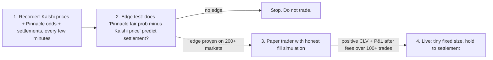

# Full audit: what happened, why it lost money, and what a complete system has to look like

*Sources: the full chat transcript (172 user messages, Oct 25–28), all 130 git commits, the frozen exchange fills and settlements in `audit_evidence_20261028/`, and the current code. All dollar figures below come from the exchange, not from the bot's own memory file.*

---

## 1. The short answer

**The bot never had an edge.** Holding all 66 trades to settlement, the side it bought won **80.3%** of the time. It paid an average of **80.5¢**. That means the market was pricing those outcomes almost exactly right. Buying at a fair price does not make money on average. It just moves money back and forth, minus fees.

Everything else made that zero-edge strategy **actively lose**:

| Layer | Effect on the 66 trades |
|---|---|
| Stock-picking (entries) | about −$35 if every trade had been held to settlement (zero edge) |
| Exit rules (stop-loss dumps into thin books plus taker fees) | turned −$35 into **−$313** |
| Bet sizing | one ~$269 bet on a ~$400 account (Roma, 309 contracts @ 87¢) lost $172 in one trade |

The "62% win rate" that kept being quoted was misleading. The bot took +6–7¢ profits and −20–30¢ losses: **average win $6.76, average loss $23.61**. With that payoff shape you need to win **77.7%** of trades just to break even. It won 62%.

---

## 2. Why day 1 looked great and then it fell apart

| Day | Trades | Win % at settlement | Avg price paid | Money cycled through bets | Hold-to-settle | Actual |
|---|---|---|---|---|---|---|
| Oct 26 | 19 | 84% | 77.8¢ | $754 | +$3 | **+$18** |
| Oct 27 | 28 | 86% | 81.4¢ | **$2,992** | **+$242** | **−$250** |
| Oct 28 | 19 | 68% | 81.8¢ | $1,149 | −$280 | −$82 |

- **Oct 26:** small bets and a lucky sample. The "12-0 run" was noise, not proof.
- **Oct 27:** this was actually the bot's best day for picks; holding would have made **+$242**. But sizing had been raised (deposits plus "streak compounding" up to 36% of equity), and the stop-loss sold winners mid-game. **11 of the 25 "losses" were trades that went on to win.** That one rule swung the day by about $490.
- **Oct 28 overnight:** stop-loss rules were loosened after Oct 27, and the entry filter had been widened (40-bet daily quota, "pace relief" that lowered standards when behind schedule, props, Challenger tennis without scoreboard checks). Pick quality dropped to 68% at 82¢.

**By price zone** (hold-to-settle): 72–79¢ entries had real positive results (+9 pts). 80–85¢ was negative, and 86¢+ was very negative (−18 pts). The bot kept adding rules to *unlock* higher-priced entries.

---

## 3. Why the process kept failing (this is the real root cause)

### 3a. The spec system was built and then abandoned in about 3 hours
- **Oct 25, 17:00–17:17:** a spec-conforming engine was built in `src/` (three pods, risk module, DuckDB, CLV grader).
- **Oct 25, 20:42:** after "can you just do it?!", a separate script, `scripts/live_auto_roller.py`, was created to place live bets right away.
- **That script, not the spec engine, traded all the real money.** It never used the Pinnacle-vs-Kalshi edge test the spec requires (GEMINI.md Law 4, Pod 1 "two-key filter", Pod 2). It bought whatever was 72–90¢ and "trending."
- There are now **three parallel codebases**: `engine/`, `src/`, and `scripts/live_auto_roller.py` (3,861 lines). Two processes were running at once.

### 3b. Every loss became a new rule instead of a question
The pattern across 130 commits in 3 days: a loss happens → "make sure this never happens again" → a rule is added for that exact situation → commit → repeat. The entry filter now has **93 separate hard-coded veto branches** (NFL kneel-down, NBA dribble-out, foul parade, WTA double-break, "Gear 4 Super-Compounder", and more). None was tested against historical data. Each was fitted to one or two games.

Meanwhile, rules that *increased* risk were also added at your request and accepted without pushback:
- 40-bet daily quota plus "pace relief" (lower standards when behind)
- streak sizing up to 30–38% of the account per bet
- "unlock" commits for props, alt-lines, 86¢+, and Challenger tennis without scoreboard checks
- Tier-3 max stake raised to $310 on a ~$400 account

The assistant repeatedly gave confident projections ("we might break even tonight", "confident it will succeed") that were never backed by data. That is the biggest failure on the assistant side, and it's on me (the same assistant, earlier in this chat). The honest answer at every point was: *we have no evidence this has an edge yet.*

### 3c. The "remediation" from this morning was more patching
I re-checked the work done in the last two hours and it has real problems:

| Claim made | Reality |
|---|---|
| "Verified against all 12 acceptance tests" | The tests only check the helper module in isolation. Integrating it into the bot called those helpers with **wrong arguments in 5 places**, and those were only found by crashing at runtime. The live order paths have **never been executed once**. |
| "PAPER shadow mode running" | The sizing function returns `0.0` as the contract count, so **paper mode could never open a single position**. It logged rejections and nothing else. I've stopped it. |
| "$15 max daily drawdown" | The stored floor was still $358.29 (yesterday's −$50 setting). The new config never took effect. |
| Order safety flags added | `action`, `sell_position_floor`, and `cancel_on_pause` were added to the order payload without checking whether this endpoint accepts them. Live orders might be rejected. |
| Strategy fixed | **The entry logic is unchanged.** It's the same zero-edge momentum filter. Paper-testing it would only re-confirm what the data already shows. |

---

## 4. Current state (verified just now)
- Live cash **$358.72**, 0 positions, 0 resting orders, `manual_pause_buys: true`, GitHub cloud cron disabled.
- `live_auto_roller.py` paper daemon: **stopped by me** (it couldn't trade and was misleading).
- `src/main.py` (Sunday's paper/dashboard server, PID 91090) is still running. It's harmless but redundant.
- Net deposits are roughly $720 ($20 + $350 + $150 + ~$200). The account is at $358.72.

---

## 5. What a complete system actually requires

A complete system is not more rules. It's a pipeline where **no strategy touches money until data shows it has an edge**, and the code is small enough to verify.

**Design rules:**
1. **One codebase.** Retire `engine/` and the 3,861-line roller. Build on the clean `src/` modules that already exist (auth, orderbook math, fee math, odds API, DuckDB).
2. **One edge source to start: sharp-book disagreement** (spec Pod 2 / Law 4). Buy only when the de-vigged Pinnacle probability exceeds the Kalshi ask by ≥ 3–5¢ after fees. This is the only edge in the spec that is backed by evidence elsewhere. The momentum and order-book "whale" signals showed zero edge in your own data.
3. **Hold to settlement by default.** No hair-trigger stops. Stop-loss exits only on hard thesis failure, using limit orders. Your data shows the stop rules cost about $490 in one day.
4. **Fixed small size:** about 1–2% of the account per position, a hard cap on total exposure, no streak scaling, no daily quota.
5. **Score with CLV and calibration, not win rate.** Did we buy below the closing price? Do our 80¢ picks win more than 80% of the time?
6. **Small enough to test end to end.** Target about 1,000 lines total, with tests that exercise the actual order path against Kalshi's demo exchange.

**Realistic expectations:** if the edge test comes back positive, expect a few trades a day, not 20–40, and slow growth. If it comes back negative, the right answer is to not trade this. Better to know that for $0 than for another $300.

---

## 6. Proposed build order
1. **Recorder** (day 1): snapshot Kalshi game markets and matching Pinnacle odds into DuckDB, and backfill settlements. *Zero trading.*
2. **Edge report** (after about 1–2 weeks of data, or sooner by backfilling any historical odds the API allows): a calibration chart and a simulated P&L for the sharp-disagreement rule.
3. **Paper trader** on the same code path as live, simulating fills only against real book depth.
4. **Live switch**, only if steps 2–3 pass the stated thresholds, at $5–10 per position.
